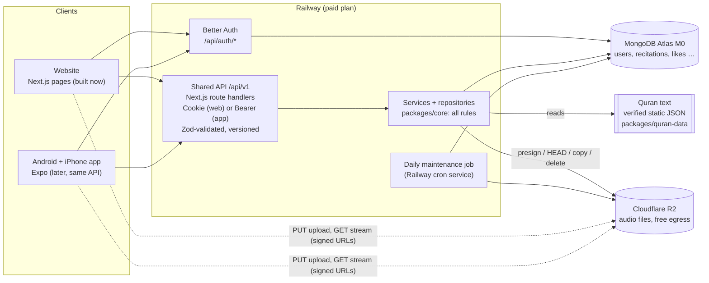
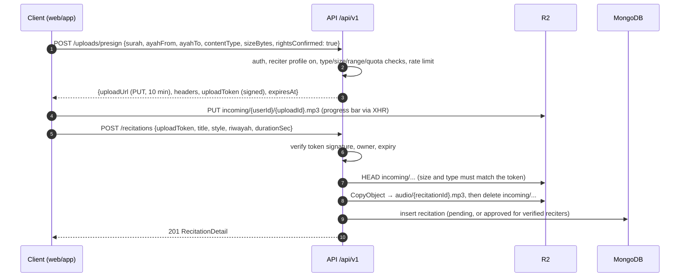

# Tilawah — Architecture

Status: **built and tested.** The memorization feature (Phase 4) was removed on 2026-11-17 at
the owner's request (§14). The decision log in
[§18](#18-decision-log) records what was decided; §19 and §20 list what Phases 2 and 3 settled
or changed.

Related: [DATA_MODEL.md](DATA_MODEL.md) · [API.md](API.md) ·
[`packages/contracts/openapi.json`](../packages/contracts/openapi.json)

---

## 1. Goals and constraints

| Goal                                    | Consequence                                                                                                                                                                           |
| --------------------------------------- | ------------------------------------------------------------------------------------------------------------------------------------------------------------------------------------- |
| Website now, Expo app later, same API   | All behaviour sits behind `/api/v1`. Business logic is in framework-free packages. No endpoint relies on cookies alone, or on HTML.                                                   |
| Free tiers, except hosting              | The app runs on the owner's existing paid **Railway** plan. Database (Atlas M0), storage (R2) and CI (GitHub Actions) stay on free tiers. No paid queue, cache or rate-limit service. |
| Audio never passes through the server   | Clients upload to and stream from R2 directly, using URLs the API signs.                                                                                                              |
| Quran text can never change by accident | The verified Tanzil file is committed byte-for-byte and protected by a SHA-256 test. It is never stored in, or edited through, MongoDB.                                               |
| Old mobile versions keep working        | Response shapes live in Zod contracts; a breaking change means `/api/v2`, never a silent edit.                                                                                        |
| One account, two sides                  | Like Fiverr's buyer/seller switch, every account can move between **listener** and **reciter** mode at any time without signing out (§5).                                             |

## 2. System diagram



Plain-text version:

```
                 web and app upload and stream audio directly (signed URLs)
        ┌───────────────────────────────────────────────────────────────────┐
        │                                                                   ▼
┌──────────────┐      ┌──────────────────────────────┐  presign   ┌──────────────────┐
│ Website      │─────▶│ Shared API /api/v1 (Railway) │───────────▶│ Cloudflare R2    │
│ Next.js      │      │ Next.js route handlers       │            │ audio, free egress│
└──────────────┘      │ Cookie (web) / Bearer (app)  │  reads     ├──────────────────┤
┌ ─ ─ ─ ─ ─ ─ ─┐      │ Zod-validated, versioned     │───────────▶│ Quran text (JSON)│
  Expo app      ─────▶└──────────────┬───────────────┘            └──────────────────┘
└ ─ ─ ─ ─ ─ ─ ─┘                     ▼
                      ┌──────────────────────────────┐            ┌──────────────────┐
                      │ Services + repositories      │───────────▶│ MongoDB Atlas    │
                      │ packages/core: all rules     │            │ users, recitations│
                      └──────────────────────────────┘            └──────────────────┘
```

## 3. Repository layout

Turborepo + pnpm workspaces. Internal packages export TypeScript source directly (no build
step); Next.js transpiles them (`transpilePackages`), Vitest and `tsx` run them natively, and
Metro will bundle them for Expo.

```
apps/
  web/                Next.js 16 (App Router): pages + /api/v1 route handlers
    app/api/v1/**/route.ts   thin handlers (Phase 2)
    server/container.ts      composition root: builds repositories + services (Phase 2)
    server/auth.ts           Better Auth instance (Phase 2)
  mobile/             placeholder README (Expo, later)
packages/
  config/             shared tsconfig, ESLint (incl. layering rules), Prettier, tsc7 wrapper
  contracts/          Zod schemas, endpoint registry, generated openapi.json   ← done
  core/               services, repositories, DomainError (no Next.js)
  api-client/         typed fetch client inferred from contracts (web + mobile)
  db/                 Mongo connection, Mongoose models, indexes, seed, maintenance job
  quran-data/         Tanzil Uthmani source file, checksums, derived JSON, metadata
  recitation/         Arabic normalization, word matcher, RecognitionEngine interface
  ui-tokens/          Mushaf design tokens for web (CSS vars) and mobile
docs/                 this file, DATA_MODEL.md, API.md (TESTING.md in Phase 2)
```

Root scripts: `pnpm dev | build | test | lint | typecheck | format | openapi | check:openapi`.

**Toolchain:** Node 24, pnpm 12, Next.js 16.4, React 19.3, Zod 4, zod-openapi 6, Vitest 5,
ESLint 10 with `typescript-eslint` strict type-checked rules.

**TypeScript: 7 for type-checking, 6 as a library.** TypeScript 7.0 (the native Go compiler)
is the best compiler available and is what `pnpm typecheck` runs, through the `tsc7` wrapper
in `packages/config` (installed as `@typescript/native`). It does not yet ship the stable
JavaScript API that typescript-eslint (supports `<6.1`) and Next.js's build-time type check
load, so TypeScript 6.0 stays installed as `typescript` for those tools only. 6.0 was released
as the bridge to 7 and gives the same results; CI runs both (typecheck with 7, `next build`
with 6), so any disagreement would fail the build. When typescript-eslint and Next.js support
7, the 6.0 dependency is removed.

pnpm's supply-chain policy is left on: dependencies younger than its minimum release age are
rejected, and only `esbuild` may run an install script.

## 4. Layering

```
route handler ──▶ service ──▶ repository ──▶ MongoDB
     │               │
     │               └──▶ storage port (R2), email port, quran-data, clock, id generator
     └── parses with contracts, resolves the Actor, maps DomainError → ErrorResponse
```

| Layer                                | May import                                       | Must not                                               |
| ------------------------------------ | ------------------------------------------------ | ------------------------------------------------------ |
| `apps/web/app/api/v1/**/route.ts`    | contracts, core (types), `server/container`      | Mongoose, MongoDB, `@tilawah/db`; any `if` about rules |
| `apps/web/app/**` pages / components | api-client, contracts, `server/container` (RSC)  | Mongoose, MongoDB, `@tilawah/db`                       |
| `packages/core` services             | contracts, quran-data, repository **interfaces** | `next`, `react-dom`, request/response objects          |
| `packages/core` repositories         | `@tilawah/db`                                    | business rules                                         |

**How it is enforced, not just documented:**

- ESLint `no-restricted-imports` bans `mongoose`, `mongodb` and `@tilawah/db` everywhere in
  `apps/web` except `server/container.ts` and `server/auth.ts`
  ([packages/config/eslint/next.js](../packages/config/eslint/next.js)).
- ESLint bans `next/*` and `react-dom` in every framework-free package
  ([packages/config/eslint/base.js](../packages/config/eslint/base.js)).
- Handlers are built from the endpoint registry, so a handler cannot accept or return
  something the contract does not describe.

**Handler shape (Phase 2).** Every handler is one call into a shared wrapper:

```ts
// apps/web/app/api/v1/recitations/[id]/like/route.ts
export const POST = route(endpoints.likeRecitation, ({ actor, params }) =>
  services.likes.like(actor, params.id),
);
export const DELETE = route(endpoints.unlikeRecitation, ({ actor, params }) =>
  services.likes.unlike(actor, params.id),
);
```

`route()` does, in order: CORS/CSRF checks → resolve the Actor from cookie or Bearer token →
enforce `endpoint.auth` → rate limit (`endpoint.rateLimit`) → parse params/query/body with the
contract → call the service → validate the result against `endpoint.response` in dev/test →
set `Cache-Control` from `endpoint.cache` → JSON. A thrown `DomainError` becomes
`{ error: { code, message, details } }` with `errorStatus[code]`; anything else becomes
`INTERNAL_ERROR` and is logged without tokens, emails or IPs.

**Server Components** call services through the same `server/container.ts` (rule 5 allows
this), passing the same Actor, so the website can never see data or rules the API does not
expose. Client Components use `@tilawah/api-client` with TanStack Query.

## 5. Accounts: authentication, modes and roles

### Authentication

**Better Auth** (v1.7) with the MongoDB adapter, mounted at `/api/auth/[...all]`.

| Concern      | Choice                                                                                                                                                                                                                                                                                 |
| ------------ | -------------------------------------------------------------------------------------------------------------------------------------------------------------------------------------------------------------------------------------------------------------------------------------- |
| Methods      | Email + password (verification and reset emails sent through Brevo, D2) and Google OAuth.                                                                                                                                                                                              |
| Web sessions | HTTP-only, `Secure`, `SameSite=Lax` cookie `tilawah.session_token` (cookie prefix `tilawah`).                                                                                                                                                                                          |
| Mobile       | `bearer` plugin enabled now, so every endpoint already accepts `Authorization: Bearer <token>`. `@better-auth/expo` plugin added with the app.                                                                                                                                         |
| User record  | Better Auth's user model is renamed to the `users` collection and extended with `role`, `mode`, `reciterSince`, `verifiedReciter`, `bio`, `country`. `role`, `reciterSince` and `verifiedReciter` are `input: false`, so users cannot set them.                                        |
| Brute force  | Better Auth's built-in rate limiter on its own routes, with a `customStorage` that HMACs its IP-based keys into our `rateLimits` collection.                                                                                                                                           |
| Actor        | `route()` calls `auth.api.getSession({ headers })`, which works for both cookie and Bearer, then reads the user's current `role`, `mode`, `reciterSince` and `verifiedReciter`. Better Auth's cookie cache is left **off**, so a mode or role change applies on the very next request. |

### Listener and reciter modes (Fiverr-style)

Every account has both sides. A switch in the header (web) or profile tab (app) calls
`PUT /me/mode` and the UI changes immediately. The session is untouched, so no sign-out or
sign-in is needed.

| Mode                   | What the user sees                                                                                                                                                                              |
| ---------------------- | ----------------------------------------------------------------------------------------------------------------------------------------------------------------------------------------------- |
| **listener** (default) | Home, browse surahs, player, library, playlists, hadith.                                                                                                                                        |
| **reciter**            | Reciter dashboard: my uploads and their review status, plays/likes stats (`GET /me/reciter/stats`), storage used, upload button, public profile preview. The player and library stay available. |

Rules:

- The **first** switch to reciter sets `reciterSince` and turns on the public reciter profile
  (`/reciters/{id}`). The switch screen says so before confirming. Switching back to listener
  only changes the UI; the profile and approved recitations stay public.
- Uploading requires the reciter profile to be on (`reciterSince` set); otherwise the API
  returns `RECITER_PROFILE_REQUIRED`. It does **not** depend on the mode currently shown, so a
  reciter browsing in listener mode on their phone is not blocked by the API.
- The mode is saved on the account, not the device, so web and app open on the same side.
- **Switching to reciter does not skip review.** Anyone could switch, so if switching meant
  auto-approval, moderation would do nothing. Auto-approval comes only from the
  `verifiedReciter` badge, which moderators and admins grant.

### Staff roles and the verified badge

`role` now covers staff permissions only: `user` (default) · `moderator` · `admin`.

| Capability                                                  | user | user + verified badge | moderator  |   admin    |
| ----------------------------------------------------------- | :--: | :-------------------: | :--------: | :--------: |
| Listen, like, report, playlists, hadith, switch modes       |  ✓   |           ✓           |     ✓      |     ✓      |
| Upload (reciter profile on)                                 |  ✓   |           ✓           |     ✓      |     ✓      |
| Uploads skip the review queue                               |      |           ✓           |     ✓      |     ✓      |
| Verified badge on profile and recitations                   |      |           ✓           | if granted | if granted |
| See pending items, approve / reject / remove, close reports |      |                       |     ✓      |     ✓      |
| Grant the badge, change roles                               |      |                       |            |     ✓      |

Auto-approval is `verifiedReciter || role ∈ {moderator, admin}`. Granting the badge also turns
on the reciter profile if it was off.

### CSRF and CORS

Cookie-authenticated `POST/PUT/PATCH/DELETE` requests must carry an `Origin` header in
`API_ALLOWED_ORIGINS`, and JSON bodies must be `application/json` (which forces a CORS
preflight cross-origin). Bearer-authenticated requests are not exposed to CSRF and skip the
origin check. Only origins in `API_ALLOWED_ORIGINS` get `Access-Control-Allow-Origin` and
`Allow-Credentials`; the native app needs no CORS because it never sends cookies.

## 6. Audio storage and upload flow

Audio never enters MongoDB. MongoDB stores the object key and metadata only.



**Object keys**

| Prefix                               | Contents              | Lifetime                                                    |
| ------------------------------------ | --------------------- | ----------------------------------------------------------- |
| `incoming/{userId}/{uploadId}.{ext}` | Unconfirmed uploads   | R2 lifecycle rule deletes after 1 day (abandoned uploads)   |
| `audio/{recitationId}.{ext}`         | Confirmed recitations | Deleted immediately when `removed`; 7 days after `rejected` |

The copy-on-confirm step is why abandoned uploads clean themselves up: only `incoming/` has a
lifecycle rule. `recitations.audioKey` has a unique index, so the same token cannot be
confirmed twice.

**Upload token.** `uploadToken` is an HMAC-SHA256-signed (`UPLOAD_TICKET_SECRET`) payload:
`{ v, userId, key, contentType, sizeBytes, surah, ayahFrom, ayahTo, rightsConfirmedAt, exp }`.
It makes the flow stateless (no "pending uploads" collection) and lets confirm reject a
tampered range or size. `exp` is the 10-minute URL lifetime plus 60 minutes, because an upload
that started before the URL expired may still be finishing. Error mapping:

| Situation                               | Code                           |
| --------------------------------------- | ------------------------------ |
| Reciter profile not turned on           | `RECITER_PROFILE_REQUIRED` 403 |
| Type not in the four allowed            | `UNSUPPORTED_MEDIA_TYPE` 415   |
| Size over 60 MB                         | `FILE_TOO_LARGE` 413           |
| Storage quota would be exceeded         | `QUOTA_EXCEEDED` 403           |
| Token expired                           | `UPLOAD_EXPIRED` 410           |
| No object in R2 for the token           | `UPLOAD_NOT_FOUND` 422         |
| Object size/type differs from the token | `UPLOAD_MISMATCH` 422          |
| Token already used                      | `CONFLICT` 409                 |

**Storage quotas (D4, approved).** 300 MB of audio per user, 2 GB for verified reciters,
summed from `recitations.sizeBytes` for non-removed items at presign time. The upload page
recommends 64–96 kbps mono, which fits a full juz in well under 100 MB.

**Playback (D3, decided: signed URLs).** One **private** bucket and a short-lived presigned
`GET` URL in every `Recitation.stream`: 6 hours for approved items, 15 minutes for
pending/rejected ones (visible only to the owner and moderators). Egress through the S3 API is
free, so streaming costs nothing; removal is instant; pending audio is never publicly
reachable. When a domain exists, setting `R2_PUBLIC_BASE_URL` (plus a second, public bucket for
approved audio) switches to permanent CDN URLs with `stream.expiresAt: null`. Clients already
handle both.

**R2 access** goes through a `StoragePort` interface in core (`presignPut`, `presignGet`,
`head`, `copy`, `delete`), implemented with `@aws-sdk/client-s3` and
`@aws-sdk/s3-request-presigner` against the R2 endpoint, and mocked with
`aws-sdk-client-mock` in tests.

## 7. Quran text

- `packages/quran-data/source/quran-uthmani.txt`: the Tanzil Uthmani file, committed exactly
  as downloaded, license header included. `source/quran-data.xml`: Tanzil metadata (names,
  ayah counts, revelation place/order, juz boundaries).
- `checksums.json` stores the SHA-256 of both. The integrity test checks the checksum, 114
  surahs and 6,236 ayahs.
- A deterministic script derives `generated/surah-NNN.json` (ayah → words, split on spaces).
  A test re-joins the words and compares with the source line, so the derivation provably
  changes nothing. Tanzil puts the bismillah at the start of ayah 1 of surahs 2–114 (except 9);
  the derivation moves it to a separate `bismillah` field and the test accounts for that
  (D14). Each surah keeps its own spelling: in 95 and 97 Tanzil writes بِّسْمِ with a shadda,
  so there is no single shared bismillah string.
- Pause marks (ۖ ۗ ۚ …), rub-el-hizb (۞) and sajdah (۩) are standalone tokens in Tanzil. They stay
  in each ayah's `text` but are not `words`, so they are not counted as words.
- The API serves the text (`GET /surahs/{n}/text`) with `Cache-Control: public, immutable` and
  an ETag of the checksum. The mobile app bundles `@tilawah/quran-data` directly for offline use.
- Attribution required by the Tanzil license (text source + link to tanzil.net) is shown in the
  footer and returned in the `source` field of every text response.

## 8. Rate limiting and play counting

**Limiter.** A fixed-window counter in MongoDB (`rateLimits` collection, TTL-indexed), keyed by
`policy : subject : windowStart`. The subject is the user id, or for anonymous requests
`HMAC(IP_HASH_SECRET, ip)`. Raw IPs are never stored. One `findOneAndUpdate` with `$inc` and
upsert per limited request. It lives in MongoDB rather than process memory so it stays correct
if Railway runs more than one replica. Policies (in `packages/contracts/src/limits.ts`):

| Policy   | Limit / window | Used by                                                               |
| -------- | -------------- | --------------------------------------------------------------------- |
| `upload` | 20 / hour      | presign, confirm                                                      |
| `write`  | 120 / hour     | edits, deletes, playlists, profile, mode switch, moderation decisions |
| `like`   | 300 / hour     | like, unlike                                                          |
| `report` | 20 / day       | report                                                                |
| `play`   | 600 / hour     | play counting                                                         |

**Plays (D11).** The client calls `POST /recitations/{id}/play` once playback passes 30 seconds
(or half the duration for short clips). The server inserts a de-duplication marker
`play:{recitationId}:{listener}` with a 6-hour TTL; if it already exists the response is
`counted: false`. Counted plays `$inc` `recitations.playCount` and the day's bucket in
`playStatsDaily` (kept 8 days), which powers `sort=trending` ("popular this week") and the
reciter dashboard's `playsLast7Days`.

## 9. Caching

`endpoint.cache` in the registry decides the header:

| Policy    | Header                                                                                                                    | Endpoints                 |
| --------- | ------------------------------------------------------------------------------------------------------------------------- | ------------------------- |
| `static`  | `public, max-age=86400, s-maxage=604800, stale-while-revalidate=86400`                                                    | surah list, surah text    |
| `shared`  | `public, s-maxage=60, stale-while-revalidate=300` **only when the request has no session**; otherwise `private, no-store` | public lists and profiles |
| `private` | `private, no-store`                                                                                                       | anything personal         |
| `none`    | `no-store`                                                                                                                | writes                    |

All responses send `Vary: Cookie, Authorization`. Railway has no CDN in front of the app, so
today these headers mainly help browsers and the mobile HTTP cache. They are already correct
for a CDN (for example Cloudflare's free proxy) once a domain exists. Because Railway runs a
long-lived Node process, surah metadata and text are loaded into memory once at startup.

## 10. API versioning

- The OpenAPI document is generated from the contracts (`pnpm openapi`) and committed.
  `pnpm check:openapi` (in CI and in the contract tests) fails if it is stale.
- `info.version` is the version of `packages/contracts/package.json`. Any change to
  `openapi.json` needs a version bump; `scripts/check-api-version.mjs` enforces this on every
  pull request against the base branch.
- **Allowed in v1 (minor bump):** new endpoints, new optional request fields, new response
  fields, new `ErrorCode` values (clients must treat unknown codes by HTTP status).
- **Requires `/api/v2`:** removing or renaming anything, making a field required or nullable,
  changing a type, adding a value to a response enum other than `ErrorCode`. Phase 2 adds an
  `oasdiff` breaking-change check (free, open source) in CI, switched on by setting the
  repository variable `API_RELEASED=true` at the first production deploy. v1 stays served
  until no installed app uses it.
- Better Auth's `/api/auth/*` endpoints are outside our versioning; the Better Auth version is
  pinned exactly and upgrades are tested against the Expo client before release.

## 11. Security

- Every input is parsed with its Zod contract; unknown keys are stripped (so a user sending
  `role` or `verifiedReciter` to `PATCH /me` has no effect, which a test covers).
- Every write checks ownership or role inside the service, not in the handler.
- Secrets only in environment variables (Railway service variables in production;
  `.env.example` lists them). Nothing secret has a `NEXT_PUBLIC_` prefix.
- Headers: HSTS, `X-Content-Type-Options`, `Referrer-Policy`, `Permissions-Policy`
  (microphone only for self), `frame-ancestors 'none'` are set now in
  [next.config.ts](../apps/web/next.config.ts). The per-request CSP with a script nonce (R2 for
  `media-src`/`connect-src`) is set in [proxy.ts](../apps/web/proxy.ts).
- **Database network access.** MongoDB stays on Atlas (confirmed). Railway's outbound IPs are
  not fixed, so Atlas's IP access list allows `0.0.0.0/0`. That is acceptable only with TLS
  (Atlas default), a long random password, and a database user limited to `readWrite` on the
  Tilawah database. If the Railway plan offers static outbound IPs, the list is restricted to
  them instead.
- Account deletion and role changes require a fresh session or admin rights respectively.
- Logging: a single logger redacts `authorization`, `cookie`, `email`, `token`, `uploadToken`
  and IP fields. Error responses never echo internals.
- Moderation and role changes record who and when on the document.

## 12. Privacy

- Data collected is limited to the fields in [DATA_MODEL.md](DATA_MODEL.md).
- **Recordings made in the browser stay on the device until the user presses Upload.**
- IPs exist only as keyed hashes in TTL-expiring rate-limit records. Better Auth's IP and
  user-agent tracking on sessions is turned off.
- Emails are returned only to their owner (`GET /me`) and to admins (`/admin/users`).
- A listener-only account has no public page. A public reciter profile exists only after the
  user chooses reciter mode, and the switch screen says so.
- The public privacy policy (`/privacy`) and terms of use (`/terms`) describe this in plain
  language (messages files, three languages).
- `DELETE /me` (D15) deletes the account and its data; the user's recitations become removed
  and their audio is deleted.

## 13. Mobile readiness checklist

- [x] Every endpoint accepts Bearer tokens (bearer plugin) as well as cookies.
- [x] No endpoint returns HTML, redirects, or relies on Server Actions, `next/headers` cookies
      inside services, or other Next.js-only features. Core packages cannot import Next.js (lint).
- [x] Request/response types come from `@tilawah/contracts`; the client is
      `@tilawah/api-client` (plain `fetch`, runs in React Native).
- [x] Uploads are a plain presigned `PUT`, which Expo's `FileSystem.uploadAsync` supports.
- [x] Stream URLs carry `expiresAt`, so a background-playing app knows when to refresh.
- [x] Quran text and the word matcher are pure packages the app bundles for offline use.
- [x] The mode switch is an API call, not a web-only setting, so the app gets the same
      listener/reciter sides.
- [x] In-app account deletion exists (`DELETE /me`), which both app stores require.
- [x] Everything the site can do has an endpoint (profile, mode, own uploads, stats,
      moderation, roles).

## 14. Memorization (removed)

Built in Phase 4 (on-device Whisper speech recognition, practice screen, `/me/memorization/*`
endpoints, `memorizationSessions` and `memorizationProgress` collections) and removed on
2026-11-17 at the owner's request. The code is in git history (branch `phase-4`, commit
`5aa300a`). Arabic normalization moved to `@tilawah/quran-data` for surah search.

## 15. Services and limits

Checked on 2026-11-12 against each provider's documentation.

| Service              | Plan and limits                                                                                                                                                                                                                                            | Our exposure and mitigation                                                                                                                                                                                                  |
| -------------------- | ---------------------------------------------------------------------------------------------------------------------------------------------------------------------------------------------------------------------------------------------------------- | ---------------------------------------------------------------------------------------------------------------------------------------------------------------------------------------------------------------------------- |
| **Railway**          | Owner's existing **paid** plan, usage-based. Default domain `<service>.up.railway.app`. **Outbound SMTP is blocked on Free, Trial and Hobby plans and allowed on Pro and above.**                                                                          | One web service plus one small cron service. Audio and uploads bypass it entirely. Email uses Brevo's HTTPS API, so the SMTP block does not matter.                                                                          |
| **MongoDB Atlas M0** | Free: 512 MB (data + indexes), 500 connections, 100 ops/s, 10 GB in + 10 GB out per rolling 7 days, 500 collections; no auto-backup (daily snapshot, 4 kept, can be enabled); pauses after 30 days with no connections.                                    | Budget in DATA_MODEL.md §4 stays around 115 MB at 10k users. One `MongoClient` per process (`maxPoolSize: 10`). TTL indexes keep rate-limit and stats data small. Put Atlas in the same cloud region as the Railway service. |
| **Cloudflare R2**    | Free: 10 GB-month storage, 1M Class A ops (writes/lists), 10M Class B ops (reads) per month, free egress. Bucket lifecycle rules supported.                                                                                                                | Storage is the binding limit; quotas (§6) and rejected-audio cleanup keep it in check. Each stream request is a Class B op; 10M/month is ample.                                                                              |
| **GitHub Actions**   | Free and unlimited for public repositories; private repositories get a monthly minute allowance on the Free plan.                                                                                                                                          | Playwright on 3 browser projects is the heaviest job; it runs only on PRs and uses the pnpm cache.                                                                                                                           |
| **Google OAuth**     | Free.                                                                                                                                                                                                                                                      | Works on the Railway domain for development and testing. Publishing the OAuth consent screen to the public may require a domain you own, which is another reason to pick one before launch.                                  |
| **Brevo** (email)    | Free: **300 emails/day** (shared by all email types), HTTPS API `POST https://api.brevo.com/v3/smtp/email` with an `api-key` header. Sender address must be verified in Brevo; authenticating a domain (SPF/DKIM/DMARC) is recommended for deliverability. | Only verification and password-reset emails, far below 300/day. An `EmailPort` with `brevo` and `none` transports; `none` in local development and tests.                                                                    |

No other services are planned. Any new one must be recorded here with its limits first.

## 16. Deployment (Railway)

The health endpoint exists (`GET /api/v1/health`), so this can be set up whenever you are ready. Railway's older
`railway.json` config-as-code is deprecated (legacy services until 2026-12-01), so the settings
are recorded here and applied with Railway's current configuration method at that point.

| Service       | Settings                                                                                                                                                                                                                                                                                                                       |
| ------------- | ------------------------------------------------------------------------------------------------------------------------------------------------------------------------------------------------------------------------------------------------------------------------------------------------------------------------------ |
| `web`         | Root: repository root. Build: `pnpm turbo run build --filter=@tilawah/web`. Start: `pnpm --filter @tilawah/web start` (Next reads Railway's `PORT`). Health check: `GET /api/v1/health`. Restart on failure. Variables: everything in `.env.example`, with `NEXT_PUBLIC_APP_URL` and `BETTER_AUTH_URL` set to the Railway URL. |
| `maintenance` | Same image, cron schedule daily at 03:00 UTC, command `pnpm --filter @tilawah/web maintenance`: deletes audio of recitations rejected more than 7 days ago, retries failed R2 deletions, and prints `dbStats` against the size budget.                                                                                         |

Deploys happen from `main` after CI passes. Node and pnpm versions come from `.nvmrc` and
`packageManager`.

## 17. Testing strategy (detail in TESTING.md, Phase 2)

Unit (Vitest) for services, permission rules, mode switching, normalization, matching,
cursors · Integration (Vitest + `mongodb-memory-server` **replica set**, needed for
transactions) for every handler with a fake-auth helper · Contract (responses parsed by their
schema; `check:openapi`; `oasdiff`) · R2 via `aws-sdk-client-mock` · Components (RTL + MSW) ·
E2E (Playwright: Chromium, WebKit, 375 px mobile; includes "switch to reciter → upload →
switch back" without signing out) · Accessibility (`@axe-core/playwright`, light/dark,
LTR/RTL). Coverage gate 80 % lines for `core` and `recitation`. No test touches a real
database, R2, or the network. Phase 2 ships 268 tests across these layers; see
[TESTING.md](TESTING.md).

## 18. Decision log

| #   | Topic                                  | Status               | Outcome                                                                                                                                                                                                       |
| --- | -------------------------------------- | -------------------- | ------------------------------------------------------------------------------------------------------------------------------------------------------------------------------------------------------------- |
| D1  | Domain name                            | **Deferred**         | Use the Railway domain for now. Everything works without a custom domain; one is needed later for a public audio CDN, best email deliverability (Brevo domain authentication), and publishing Google sign-in. |
| D2  | Email provider                         | Decided              | **Brevo** (free, 300/day, HTTPS API, works on any Railway plan).                                                                                                                                              |
| D3  | Playback URLs                          | Decided (follows D1) | Private bucket + signed GET URLs.                                                                                                                                                                             |
| D4  | Storage quotas and cleanup             | Approved             | 300 MB per user, 2 GB verified, rejected audio deleted after 7 days.                                                                                                                                          |
| D5  | Hosting                                | **Changed**          | Railway (paid plan) instead of Vercel.                                                                                                                                                                        |
| D6  | Endpoints beyond the spec              | Approved, extended   | Plus `PUT /me/mode`, `GET /me/reciter/stats`, `DELETE /me`.                                                                                                                                                   |
| D7  | Fields and collections beyond the spec | Approved, extended   | Plus `users.mode`, `users.reciterSince`.                                                                                                                                                                      |
| D8  | Roles                                  | **Changed**          | Fiverr-style listener/reciter mode switch for every account; `role` is staff-only (`user/moderator/admin`); verified badge is granted by staff and is the only route to auto-approval (§5).                   |
| D9  | Owner edits after approval             | Default kept         | Changing surah, range or riwayah sends a non-verified owner's recitation back to pending.                                                                                                                     |
| D10 | Riwayah values                         | Default kept         | 20 canonical transmissions, lowercase ids, default `hafs`.                                                                                                                                                    |
| D11 | What counts as a play                  | Default kept         | 30 s or 50 %; once per listener per 6 h; trending = 7 days.                                                                                                                                                   |
| D12 | Session retention                      | Default kept         | Sessions 365 days, progress indefinitely.                                                                                                                                                                     |
| D13 | TypeScript                             | Decided              | TypeScript 7 for type-checking, 6.0 kept as the library for typescript-eslint and Next.js (§3).                                                                                                               |
| D14 | Bismillah                              | Default kept         | Separate field; text bytes unchanged.                                                                                                                                                                         |
| D15 | Account deletion                       | Approved             | `DELETE /me`.                                                                                                                                                                                                 |

D9–D12 and D14 were not commented on, so the recommendations stand; any of them is easy to
change before Phase 2.

**Resolved in the second review (2026-11-12):**

- **Database:** MongoDB Atlas (free M0), confirmed. Railway connects over TLS. The Atlas IP
  access list allows `0.0.0.0/0` (Railway's outbound IPs are not fixed), protected by a long
  random password and a database user with `readWrite` on the Tilawah database only.
- **Email (D2): Brevo.** Emails go through Brevo's HTTPS API (`EMAIL_TRANSPORT=brevo`,
  `BREVO_API_KEY`, `EMAIL_FROM`), so the Railway plan no longer matters. Until there is a
  domain, the sender is a single verified address. Sources disagree on whether Brevo now
  insists on an authenticated domain, and mail from a free-mailbox sender (for example Gmail)
  can land in spam, so the first real verification email is checked by hand at deploy time.
  When a domain exists, authenticate it in Brevo (SPF, DKIM, DMARC).

## 19. What Phase 2 settled or changed

- **Presigned uploads sign both `Content-Length` and `Content-Type`.** By default the AWS
  presigner signs only the length; `signableHeaders` adds the type, so R2 itself rejects an
  upload whose size or type differs from what was presigned. Confirm still checks with `HEAD`.
- **The upload id is the recitation id.** A second confirm of the same token is a clean
  `CONFLICT`, not a missing-file error.
- **Likes:** a duplicate-key error aborts a MongoDB transaction, so the like transaction checks
  for an existing like first and treats a concurrent duplicate as "already liked".
- **Better Auth IP handling:** `disableIpTracking` would also turn off its IP-based sign-in rate
  limit, so instead a database hook stores sessions without IP or user agent, and the limiter
  keeps only HMAC-hashed keys in our `rateLimits` collection.
- **Client IP for rate limits** is the last `X-Forwarded-For` entry (the one Railway's proxy
  appends), then `X-Real-IP`. Confirm Railway's exact headers on the first deploy.
- **Matcher:** isti'adha and a bismillah said before reciting are filtered as phrases, because
  "بالله" is within the 0.8 similarity threshold of "الله". أعوذ still matches when it is the
  expected word (surahs 113, 114).
- **Seed script location:** `apps/web/scripts/seed.ts`, not `packages/db`, so demo accounts are
  created through real Better Auth sign-up (correct password hashing) instead of copying Better
  Auth internals into the db package. The maintenance job is `apps/web/scripts/maintenance.ts`.
  Dev scripts share the composition root's permission to use the database (ESLint exception).
- **Browser E2E and accessibility tests** need pages, so they arrive with Phase 3. Phase 2
  covers the same main story at the API level (`apps/web/test/flow.test.ts`).
- **`recitations.audioDeletedAt`** was added so audio deletion can be retried and audited.
- **MongoDB in tests is 8.0.12**, matching Atlas M0, not the memory server's 8.2 default.

## 20. What Phase 3 settled or changed

- **Quran font: Amiri Quran for now.** The official King Fahd Complex font page was unreachable
  (404) and third-party sources disagree on whether KFGQPC Uthmanic Script HAFS may be
  redistributed. Committing the file would redistribute it, so the site self-hosts Amiri Quran
  (SIL Open Font License, designed for Uthmani text, recommended by Tanzil). The CSS stack
  already lists `KFGQPC Uthmanic Script HAFS` first; adding the file later is a one-line
  `next/font/local` change once the licence is confirmed.
- **Entrance animations are CSS, interactions use Motion.** Server-rendered content must be
  visible before JavaScript runs (no-JS users, LCP). The 150 ms page fade and the 30 ms list
  stagger are CSS keyframes with the spec's easing; Motion drives the player's shared-element
  transition, the play/pause morph, word reveal and dialogs. Reduced motion turns movement into
  opacity changes in both.
- **Surah page views are URLs:** `/surahs/[n]` (recitations) and `/surahs/[n]?view=read` (text).
  The default page stays light (Al-Baqarah went from 82 to 99 in Lighthouse) and the reading view
  is still fully server-rendered for search engines.
- **Waveform on intent.** Decoding audio for the peaks cost up to 650 ms of main-thread time, so
  the recitation page shows a placeholder waveform and decodes the real one when the pointer
  reaches it, it is touched, or the recitation starts playing (85 → 98–100).
- **Metadata is never streamed** (`htmlLimitedBots: /.*/`), so every crawler and link preview gets
  complete `<head>` tags. Detail pages share one data lookup between metadata and page (`cache`).
- **CSP with per-request nonces** (`proxy.ts`): scripts need the nonce (`strict-dynamic`), styles
  allow `'unsafe-inline'` because React, Motion and Radix render style attributes, R2 is allowed
  for media and uploads. Zod runs in `jitless` mode so its eval probe does not trip the CSP.
- **Local-disk storage driver** for development and end-to-end tests when R2 is not configured:
  HMAC-signed, expiring URLs served by `/api/dev-storage/*` with Range support. Production still
  requires R2 unless `STORAGE_DRIVER=local` is set explicitly.
- **`AUTH_RATE_LIMIT=off`** exists only for the E2E stack (one browser signs in many times); the
  environment check refuses it in production unless local test storage is in use.
- **Secure cookies follow the site's protocol** (`https://` in `BETTER_AUTH_URL`), and
  `upgrade-insecure-requests` is only sent over HTTPS, so a production build works on
  `http://localhost` for tests.
- **Contrast:** all spec colour pairs pass WCAG AA except light-mode success green on
  `surface-raised` (4.22:1); success text is only placed on `bg` or `surface`, enforced by a test.
  Form controls use `text-muted` for their border (5:1) instead of the decorative `border` token.
- **Reciter studio and settings pages** were added for the mode switch (dashboard, uploads with
  review status and rejection reasons, storage) and for profile, appearance and account deletion.
- **Record in the browser** (added after review): the upload page offers "Choose a file" or
  "Record now". Recording uses `MediaRecorder` (WebM/Opus in Chrome and Firefox, MP4 in Safari,
  64 kbps mono, no echo cancellation or noise suppression so the voice is not reshaped), with a
  timer, level meter, pause/resume, preview, a 3-second minimum and automatic stop before 60 MB
  or 60 minutes. The duration comes from the recorder's own clock because Chrome's WebM files
  carry none; the file then goes through the same presigned upload and review as a picked file.
  The audio stays on the device until Upload. Known limit: Chrome's WebM recordings have no seek
  index, so seeking in them can be less precise than in MP3 files.

## 21. What else changed during Phase 4

The memorization changes are gone with the feature (§14). These remain:

- **Email verification is required to sign in for ordinary users** (`role: user`) whenever email
  is configured (`EMAIL_TRANSPORT=brevo`). Sign-up sends the link and does not sign in; the link
  verifies and signs in. A blocked sign-in returns `403 EMAIL_NOT_VERIFIED` and the form offers to
  resend the link. Moderators and admins are exempt. Google accounts arrive verified. With
  `EMAIL_TRANSPORT=none` (tests, offline development) nothing can be verified, so it is not enforced.
- **Staff have their own area.** Moderators and admins see only Moderation (and Users for admins)
  in the header, with no mode switch or upload button; listener pages (home, library, studio,
  upload) redirect them to `/moderation`. Public surah and recitation pages stay
  reachable for context.
- **Admin Users page** (`/admin/users`): overview totals (`GET /admin/stats`: accounts, reciters,
  staff, unverified emails, recitations by status, open reports, plays this week, stored audio)
  and every account newest first (`GET /admin/users`: search in name or email, role filter,
  recitation counts, cursor pages). "Manage" grants the verified badge or changes the role (an
  admin cannot change their own role).
- **Fewer database round trips per request.** Better Auth's session check is cached in a signed
  cookie for 5 minutes (role and mode are still read fresh), and the user record is loaded once per
  page instead of three times: a signed-in page went from 7 to 4 queries. With a remote database
  every round trip counts: keep Railway and Atlas in the same region.
- **An account is required for everything except the landing page and sign-in** (the user's
  decision, replacing public listening). Pages: `proxy.ts` redirects requests without a session
  cookie to `/auth/sign-in?next=…`, and the `app/(member)` layout verifies the session on the server.
  API: every content endpoint is `auth: 'user'` with private caching; only `/health` stays public.
  The landing page shows no recitations. Consequence: surah and recitation pages are no longer
  indexed by search engines, and shared links ask the visitor to sign in first.

## 22. Hadith

Sahih al-Bukhari (7,577 hadith, 97 books) and Sahih Muslim (7,474, introduction + 56 books) in
Arabic, English and Urdu, from [hadith-api](https://github.com/fawazahmed0/hadith-api) pinned to
commit `df57907b` (`packages/hadith-data`). The six source files are SHA-256-verified and not
committed (41 MB); `pnpm --filter @tilawah/hadith-data generate` downloads and verifies them and
writes one file per book with the three languages joined by hadith number, texts verbatim.
Upstream chapter ranges overlap in three Sahih Muslim books (16, 36, 43); a chapter that starts
before the previous one ends starts right after it. `generated/HASHES.json` lets the tests detect
any hand edit.

- **Licensing (the user's decision):** the Arabic is classical text. The English translations
  (Muhammad Muhsin Khan, Abdul Hamid Siddiqui) are formally under publisher copyright, and the
  Urdu translator is not named in the source. They are used with credit on every page and a
  "Report a rights issue" link (`NEXT_PUBLIC_CONTACT_EMAIL`).
- **API** (`/hadith/books`, `/{book}`, `/{book}/sections/{n}`, `/{book}/hadiths/{number}`,
  `/{book}/search`): sign-in required. Search ignores diacritics and Arabic/Urdu letter variants,
  matches every word across the three languages, and treats a number as a hadith number.
- **Pages** (`/hadith`, `/hadith/{book}`, `/hadith/{book}/{n}`, `/hadith/{book}/n/{number}`):
  Arabic always, English and Urdu switchable (remembered); search results replace the book list
  and show excerpts with the matched words marked. Chapter titles are English in every language
  (the source has no Arabic or Urdu titles).
